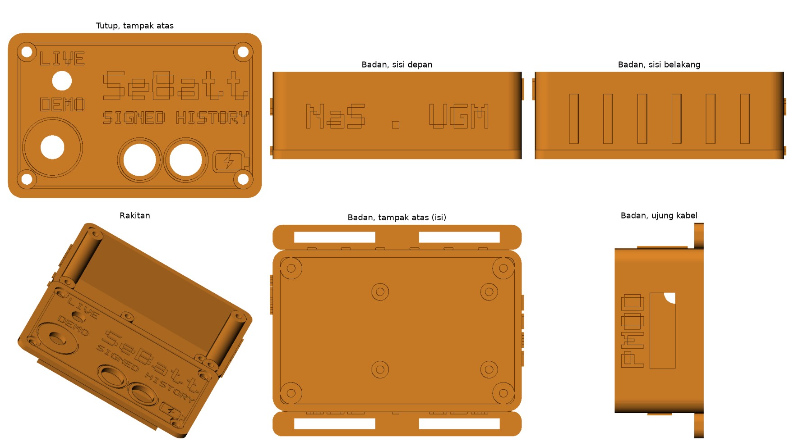

# Casing SeBatt

Casing "Smart Battery Module" yang ditempel ke baterai 12 V untuk demo. Isinya perfboard 3×4 cm dengan pembagi tegangan dan modul ADS1115, potensiometer, saklar LIVE/DEMO, dan dua LED 10 mm.



| File | Isi |
|---|---|
| sebatt_badan.stl | Badan dengan flens strap, bos sekrup, dan dudukan perfboard |
| sebatt_tutup.stl | Tutup, sudah dalam posisi cetak (muka atas menghadap bed) |
| sebatt_plat_cetak.stl | Badan dan tutup berdampingan dengan jarak 8 mm, untuk dicetak sekaligus |
| buat_casing.py | Skrip pembuat STL. Ukuran dapat diubah di bagian PARAMETER |
| pratinjau.png | Gambar pratinjau dari skrip |
| pratinjau_plat.png | Susunan badan dan tutup di plat cetak |

## Ukuran

- Badan 80 × 52 × 28 mm, ditambah flens strap 8 mm di kedua sisi panjang (lebar total 68 mm).
- Tutup 80 × 52 × 2,4 mm dengan bibir 4 mm yang masuk ke badan.
- Ruang dalam 75 × 47 × 24 mm (bawah tutup sampai lantai).
- Plat cetak gabungan 82 × 128 mm, muat di bed 220 × 220 mm.

## Pengaturan Cetak

| Pengaturan | Nilai |
|---|---|
| Bahan | PLA atau PETG |
| Nozzle | 0,4 mm |
| Tinggi lapisan | 0,2 mm (0,16 mm untuk ukiran yang lebih rapi) |
| Dinding | 3 perimeter |
| Infill | 20% |
| Support | Tidak perlu |
| Orientasi | Pakai sebatt_plat_cetak.stl apa adanya: badan berdiri dengan bukaan di atas, tutup dengan muka bertulisan menempel di bed |

Ukiran pada tutup dapat diisi cat akrilik lalu permukaannya diseka, agar tulisan lebih kontras.

## Komponen Perakitan

| Barang | Jumlah | Fungsi |
|---|---|---|
| Sekrup M3 × 10 mm (self-tapping untuk plastik) | 4 | Menutup tutup ke bos sudut |
| Sekrup M2,5 × 6 mm | 4 | Perfboard ke dudukan. Lubang perfboard dibor menyesuaikan posisi dudukan (2,5 mm dari tiap sudut) |
| Potensiometer 10 kΩ dengan bushing M7 dan kenop | 1 | Lubang tutup 7,5 mm |
| Saklar toggle mini SPDT (lubang 6 mm) | 1 | LIVE/DEMO |
| LED 10 mm hijau dan merah | 2 | Lubang tutup 10,2 mm |
| Strap velcro lebar 25 mm | 2 | Melewati slot flens dan melingkari baterai |
| Grommet karet 7 mm (opsional) | 1 | Lubang kabel baterai |

## Penempatan

```
Tampak atas (tutup)

  LIVE          SeBatt
  [saklar]      SIGNED HISTORY
  DEMO
  (kenop)            (LED hijau) (LED merah)   [ikon baterai]

Ujung kiri: lubang kabel baterai 12V (+ −)
Ujung kanan: celah kabel PMOD ke KV260
```

Potensiometer dan saklar berada di sisi kiri yang kosong. Perfboard 3×4 cm (dipotong dari perfboard yang lebih besar) menempati sisi kanan (x 32–72 mm) di atas dudukan setinggi 3,5 mm, sehingga badan potensiometer tidak menabrak komponen di perfboard. Komponen di perfboard dijaga di bawah 10 mm agar tidak menyentuh kaki LED.

## Membuat Ulang STL

```
python -m venv cad-venv
cad-venv/Scripts/python -m pip install manifold3d trimesh numpy matplotlib
cad-venv/Scripts/python buat_casing.py
```

Rangkaian di dalam casing dijelaskan di [rangkaian ADC](../docs/catatan-teknis/rangkaian-adc.md).
