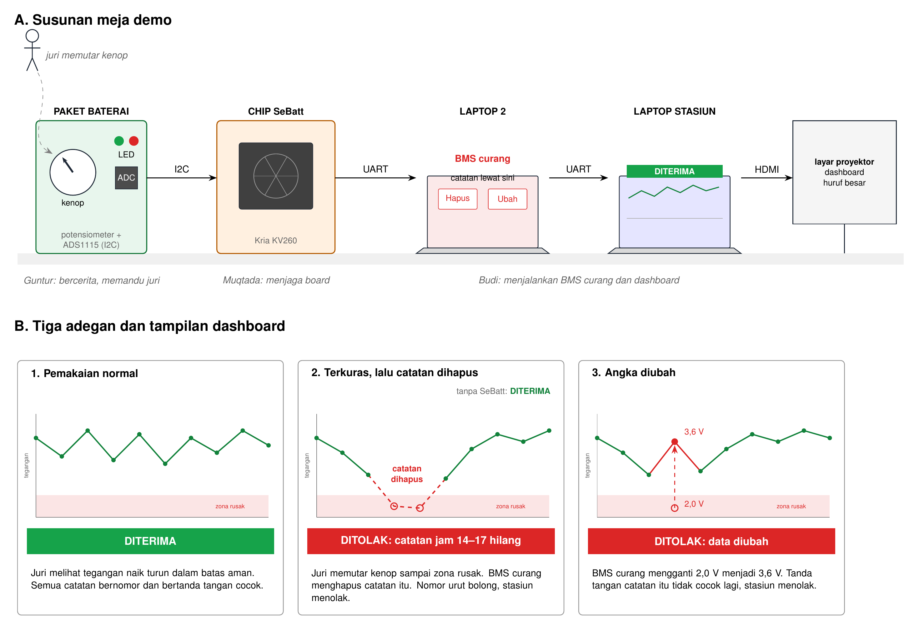

# Alur Demo SeBatt



Rencana demo sekitar 60 detik di dalam pitch 5 menit. Penjelasan teknis alurnya ada di [alur-teknis.md](alur-teknis.md).

## Ringkasan Kebutuhan

### Perangkat keras

| Barang | Jumlah | Keterangan | Penanggung jawab |
|---|---|---|---|
| AMD Kria KV260 + SD card + adaptor daya | 1 | Dari panitia. Berperan sebagai chip SeBatt | Muqtada |
| Modul ADC I2C (ADS1115) | 1 + 1 cadangan | Dibawa sendiri; VDD 3,3 V, addr 0x48 (ADDR→GND) | Guntur |
| Potensiometer 10 kΩ dengan kenop besar | 1 + 1 cadangan | Kenop yang diputar juri | Guntur |
| Adaptor USB-UART (CP2102) | 2 + 1 cadangan | Board ke laptop stasiun (TX/RX disilang, GND disambung); tambah satu lagi bila memakai laptop BMS perantara | Guntur |
| LED besar merah dan hijau + resistor | 2 set | Penanda di breadboard, terlihat dari jauh | Guntur |
| Breadboard dan kabel jumper | Secukupnya | Dari panitia atau bawa sendiri | Guntur |
| Kotak berlabel "PAKET BATERAI" | 1 | Tempat potensiometer dan ADC | Budi |
| Label "CHIP SeBatt" | 1 | Ditempel di KV260 | Budi |
| Laptop stasiun | 1 | Menjalankan dashboard, tersambung ke proyektor | Budi |
| Laptop BMS curang | 1 | Opsional; dashboard mode `--fpga` sudah punya tombol Hapus/Ubah di sisi host | Guntur |
| Kabel HDMI dan konverter | 1 set | Untuk proyektor | Budi |
| Flashdisk | 1 | Bitstream, dataset, video cadangan | Semua |

**Wiring ADS1115 (3,3 V):** VDD → 3,3 V, GND → GND, SCL/SDA → dua pin I2C FPGA,
ADDR → GND (alamat `0x48`), AIN0 → wiper potensiometer, ujung potensiometer →
3,3 V dan GND. Modul ADS1115 umumnya sudah punya pull-up 10 kΩ di SCL/SDA;
kalau tidak, tambahkan 4,7 kΩ ke 3,3 V.

### Perangkat lunak dan file

| Item | Penanggung jawab |
|---|---|
| Bitstream SeBatt untuk KV260 dan langkah memuatnya (xmutil/fpgautil) | Muqtada |
| Dashboard stasiun: grafik riwayat, tabel catatan, kartu kesehatan baterai, banner hasil | Budi |
| Tombol serangan Hapus catatan / Ubah angka di dashboard mode `--fpga`; program perantara opsional | Budi |
| Dataset pengosongan baterai sebagai input cadangan | Budi |
| Video demo lengkap sebagai cadangan terakhir | Guntur |
| Slide pembanding "BMS biasa: DITERIMA" dan "SeBatt: DITOLAK" | Guntur |

### Peran saat tampil

| Orang | Peran |
|---|---|
| Guntur | Bercerita dan memandu juri memutar kenop |
| Budi | Mengoperasikan dashboard, termasuk tombol serangan Hapus/Ubah |
| Muqtada | Menjaga board, siap menjawab pertanyaan teknis RTL |

## Susunan Meja

```
[Kotak PAKET BATERAI]         [KV260 "CHIP SeBatt"]                     [Laptop stasiun] → proyektor
 kenop + ADS1115 + LED  ──I2C──→   rangkaian SeBatt  ──UART──→  dashboard + tombol Hapus/Ubah
```

Data mengalir dari kiri ke kanan. Pada implementasi dashboard mode `--fpga`, serangan dilakukan di laptop stasiun: dashboard mengambil dump bertanda tangan dari board, mengubah salinan di memori, lalu memverifikasinya. Kunci HMAC tetap hanya ada di FPGA.

Bila ingin memperlihatkan penyerang fisik di tengah jalur, susunan lama dengan laptop BMS curang tetap bisa dipakai: board → laptop BMS (hapus/ubah byte) → laptop stasiun. Dashboard menerima data dari perantara itu; program perantaranya belum termasuk dalam repo ini.

## Konversi Tegangan

Potensiometer menghasilkan 0–3,3 V ke ADS1115 (AIN0, rentang ±4,096 V, LSB 0,125 mV). Dashboard menampilkannya sebagai tegangan satu sel Li-ion dengan skala 0–4,2 V, seolah melalui pembagi tegangan.

| Posisi kenop | Tegangan sel di layar | Zona |
|---|---|---|
| Atas | 4,2 V | Penuh |
| Tengah | sekitar 3,3–3,7 V | Pemakaian biasa |
| Bawah | di bawah 2,5 V | Merah: terkuras dalam |

Satu titik grafik mewakili 3 jam pemakaian, sehingga 64 titik mewakili sekitar 8 hari.

## Persiapan 10 Menit Sebelum Tampil

- [ ] KV260 menyala, bitstream termuat, LED hijau berkedip saat sampel diambil
- [ ] Laptop stasiun tersambung ke UART board, dashboard mode `--fpga` menerima data
- [ ] Uji coba singkat: satu putaran normal menghasilkan DITERIMA
- [ ] Buffer dan basis data dikembalikan ke kondisi awal demo
- [ ] Dashboard layar penuh dengan huruf besar, terminal disembunyikan
- [ ] Video cadangan terbuka di laptop stasiun dan siap diputar
- [ ] Kenop di posisi tengah

## Alur Demo

### Adegan 1. Pemakaian normal (sekitar 15 detik)

| Siapa | Melakukan |
|---|---|
| Guntur | "Ini paket baterai motor listrik. Chip SeBatt mencatat tegangannya setiap beberapa jam." Memutar kenop naik turun di zona normal |
| Layar | Grafik bergerak, setiap titik bernomor dan bertanda ✓ |
| Budi | Menekan "Tukar baterai" |
| Layar | Banner hijau **DITERIMA**. Kartu kesehatan: siklus sekian, terkuras dalam 0 kali, riwayat TERVERIFIKASI |

### Adegan 2. Terkuras lalu catatan dihapus (sekitar 25 detik)

| Siapa | Melakukan |
|---|---|
| Guntur | "Sekarang Bapak/Ibu yang memakai baterainya." Mempersilakan juri memutar kenop sampai bawah |
| Layar | Grafik turun ke zona merah, misalnya 2,0 V. Juri melihat sendiri kejadiannya terekam |
| Guntur | "Baterai ini sekarang rusak. Pemiliknya ingin menjual atau menukarnya tanpa ketahuan, jadi BMS yang dimodifikasi menghapus catatan itu." |
| Budi | Di dashboard, menekan **Muat riwayat** lalu **Hapus catatan** untuk catatan di zona merah, lalu **Tukar baterai** |
| Layar | Slide pembanding sebentar: tanpa SeBatt, riwayat terlihat bersih dan **DITERIMA** |
| Layar | Dashboard SeBatt: banner merah **DITOLAK, catatan jam 14–17 hilang**. Baris yang hilang ditandai merah di tabel |

### Adegan 3. Angka diubah (sekitar 15 detik)

| Siapa | Melakukan |
|---|---|
| Guntur | "Kalau tidak dihapus, bagaimana kalau angkanya diganti?" |
| Budi | Menekan **Ubah angka**: 2,0 V diganti menjadi 3,6 V, lalu **Tukar baterai** |
| Layar | Banner merah **DITOLAK, data diubah**. Baris yang diubah ditandai merah |
| Guntur | "BMS bisa mengubah angka, tetapi tidak bisa membuat tanda tangannya, karena kuncinya hanya ada di dalam chip." |

### Penutup (sekitar 5 detik)

Guntur: "Demo ini memakai tegangan rendah dan ADC terpisah. Pada chip akhir, ADC berada di dalam chip yang sama."

## Kalau Ada yang Gagal

| Kejadian | Tindakan |
|---|---|
| Board tidak merespons dalam 10 detik | Budi langsung memutar video cadangan. Guntur tetap bercerita mengikuti video |
| ADC tidak terbaca | Dashboard beralih ke mode dataset. Guntur menyebut "input dari data rekaman" |
| Laptop BMS curang bermasalah | Tidak dipakai pada mode host-side; untuk mode perantara, lewati adegan 2 dan 3 live dan putar potongan video |
| Proyektor bermasalah | Putar laptop stasiun menghadap juri, perbesar tampilan |

## Disiapkan untuk Tanya Jawab

Tidak ditampilkan di demo utama, tetapi siap dijalankan bila juri bertanya.

| Pertanyaan | Yang ditunjukkan |
|---|---|
| "Bagaimana kalau jawaban lama dikirim ulang?" | Sudah diuji di KV260: perintah `attack replay` di station CLI memakai dump untuk nonce lama, hasilnya DITOLAK (INVALID_HMAC, tanda tangan ringkasan tidak cocok dengan nonce baru) |
| "Bagaimana kalau dicoba terus?" | Tiga kali gagal berturut-turut, LED merah menyala, chip terkunci |
| "Bagaimana kalau dayanya dicabut?" | Cabut daya board, nomor urut kembali ke 0, stasiun menolak: penghitung diputar balik. Akui bahwa produk membutuhkan memori permanen |
| "Apa bedanya dengan chip yang sudah ada?" | Slide pembanding BQ40Z50 (SHA-1 untuk keaslian paket, lifetime log tanpa tanda tangan) dan contoh alat reset siklus baterai iPhone. Sebut juga MAX17205: SHA-256, tetapi tetap anti-kloning paket, bukan integritas riwayat |

## Latihan

- Ulangi demo lengkap minimal lima kali sebelum 23 Oktober, dengan urutan dan kalimat yang sama.
- Satu kali latihan dilakukan dengan video cadangan, agar perpindahannya lancar.
- Tanyakan ke panitia: ukuran meja, ketersediaan proyektor dan colokan listrik, serta waktu pasang sebelum giliran tampil.
