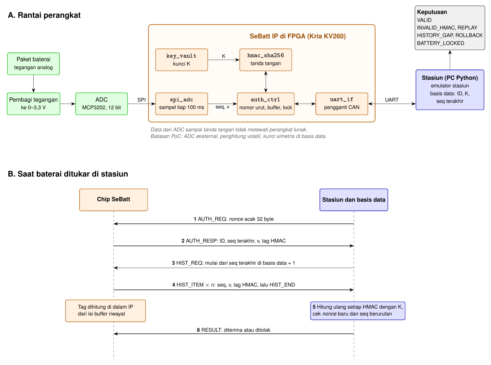

# Alur Teknis SeBatt



Gambar di atas adalah arsitektur yang dijanjikan di proposal dan sudah diimplementasikan di RTL (lolos simulasi, belum diuji di board). Dokumen ini menjelaskannya sebagai satu alur berurutan, dari baterai dibuat sampai stasiun memutuskan menerima atau menolak. Contoh angka dipakai di setiap langkah. Tegangan ditulis dalam volt agar mudah dibaca, padahal yang tersimpan di chip berupa angka mentah dari ADC.

## Dua Istilah yang Perlu Dipahami Dulu

**Nomor urut (seq).** Angka yang menempel pada setiap catatan tegangan, mirip nomor halaman buku. Angka ini hanya dapat bertambah satu: 121, 122, 123, dan seterusnya. Apabila ada catatan yang dibuang, urutannya akan bolong, misalnya 149 langsung ke 153.

**Tanda tangan (tag HMAC).** Kode 32 byte yang dihitung dari isi catatan dan kunci rahasia K. Sifatnya:
- isi catatan berubah sedikit saja, kodenya berubah total,
- tanpa K, kode yang benar tidak dapat dibuat,
- siapa pun yang memegang K dapat menghitung ulang kode tersebut untuk memeriksa.

K hanya dimiliki chip dan basis data operator.

## Kenapa Riwayat Tegangan Penting

Tegangan yang turun saat baterai dipakai adalah hal normal. Yang dicari SeBatt adalah kejadian ketika tegangan keluar dari batas aman, karena kejadian itu merusak sel secara permanen.

Contoh untuk satu sel Li-ion NMC (angka berbeda untuk jenis sel lain, cek datasheet sel yang dipakai):

| Kondisi | Tegangan per sel | Arti |
|---|---|---|
| Penuh | sekitar 4,2 V | Normal |
| Pemakaian biasa | 4,2 V turun ke sekitar 3,3 V | Normal |
| Batas bawah aman | sekitar 2,5–3,0 V | BMS seharusnya memutus arus |
| Terkuras dalam | di bawah batas aman, misalnya 2,0 V | Kapasitas turun permanen dan sel berisiko saat diisi lagi |
| Kelebihan isi | di atas sekitar 4,2 V | Merusak dan berisiko panas |

Zona merusak biasanya tersentuh karena baterai dibiarkan kosong berminggu-minggu, BMS di-bypass, atau pengisian memakai charger yang tidak sesuai. Pemiliknya memiliki alasan untuk menyembunyikan kejadian ini saat menjual baterai bekas, mengajukan klaim garansi, atau menukar baterai sewaan.

Stasiun hanya melihat tegangan saat ini. Baterai yang minggu lalu terkuras sampai 2,0 V lalu diisi penuh lagi terlihat normal di 4,2 V. Hanya riwayat yang menunjukkan kejadian tersebut, dan SeBatt memastikan riwayat itu tidak dapat dihapus atau diubah tanpa ketahuan.

Batasannya, tegangan paket dapat menutupi satu sel yang rusak. Produk yang lebih lengkap mencatat tegangan per sel, arus, dan suhu.

Masalah serupa sudah terjadi di HP. iPhone menampilkan jumlah siklus dan kesehatan baterai, tetapi di pasar servis beredar alat yang diiklankan dapat menulis ulang kedua data tersebut. SeBatt membawa persoalan yang sama ke baterai kendaraan listrik, yang harganya jauh lebih tinggi.

## Langkah 0. Saat Baterai Dibuat

1. Chip SeBatt dipasang di dalam paket baterai, bersama ADC dan pembagi tegangan.
2. Chip diberi ID, misalnya BAT-0001, dan kunci rahasia K.
3. Basis data operator mencatat: ID = BAT-0001, kunci = K, seq terakhir = 0.

## Langkah 1. Selama Baterai Dipakai (Berulang Terus)

Langkah ini berjalan sendiri di dalam chip setiap selang waktu tertentu (1 detik pada demo, yang mewakili 3 jam pemakaian). Tidak ada perangkat lunak yang ikut campur.

1. **Ukur.** ads1115_ctrl meminta modul ADS1115 (lewat I2C) membaca tegangan paket. Contohnya, hasilnya 3,7 V.
2. **Beri nomor.** auth_ctrl menaikkan penghitung, misalnya dari 120 menjadi 121.
3. **Tandatangani dan simpan.** auth_ctrl menghitung tag HMAC atas `0x53 || ID || 121 || 3,7 V`, lalu menulis (121, 3,7 V, tag) ke buffer riwayat di dalam chip.

Setelah beberapa hari, isi buffer kira-kira seperti ini:

| seq | Tegangan |
|---|---|
| 121 | 3,7 V |
| 122 | 3,6 V |
| … | … |
| 150 | 2,0 V (baterai terkuras dalam) |
| … | … |
| 184 | 3,8 V |

Buffer menampung 64 catatan terakhir. Saat penuh, catatan paling lama ditimpa.

Catatan **sudah ditandatangani saat diambil**. Buffer berada di dalam chip dan tidak dapat diubah oleh BMS atau program apa pun.

> **Status implementasi 21 Oktober:** sampling periodik 1 detik, penomoran `seq`,
> buffer 64 catatan bertag, `READ_HIST`, dan lock sudah ada di `auth_ctrl`.
> Regresi cocotb 24/24. Bitstream KV260 dibangun ulang (WNS +1,466 ns), dan di
> KV260 sudah diuji 21 Okt: AUTH dan READ_HIST VALID, riwayat yang diubah,
> dihapus, dipotong, atau diputar ulang ditolak.

## Langkah 2. Baterai Masuk Stasiun

1. Stasiun membuat angka acak baru (nonce), misalnya 7f3a…, lalu mengirimnya ke chip. Nonce yang selalu baru mencegah jawaban lama dipakai ulang.
2. Chip membalas dengan ID, tegangan sampel terbaru (3,8 V), dan tanda tangan HMAC atas `0x41 || nonce || ID || tegangan`.
3. Stasiun memverifikasi tanda tangan itu, lalu mengirim `READ_HIST_REQ` dengan nonce baru. Basis data tahu seq terakhir yang pernah diverifikasi, misalnya 120, dan akan memakai angka itu sebagai jangkar.

## Langkah 3. Chip Mengirim Riwayat yang Sudah Ditandatangani

Buffer sudah berisi catatan bertag. Saat menerima `READ_HIST_REQ`, chip mengirim:

1. Jumlah catatan, misalnya 64.
2. Rentang seq, misalnya 121–184.
3. Setiap catatan `(seq, tegangan, tag)` dari yang tertua ke terbaru.
4. Satu tag ringkasan atas `0x48 || nonce || ID || seq_tertua || seq_terakhir`.

Tag per catatan dibuat saat sampel diambil, bukan saat dump. Tag ringkasan mengikat nonce ke rentang yang benar-benar ada, sehingga BMS tidak bisa membuang catatan terbaru lalu mengirim rentang yang tampak utuh.

Selama riwayat dikirim (sekitar 215 ms untuk 64 catatan), buffer dan tag dibekukan. Sampel yang selesai pada saat itu ditahan, lalu disimpan setelah pengiriman selesai, sehingga isi dump selalu sama dengan rentang yang ditandatangani di tag ringkasan.

Setelah keluar dari chip, catatan dan tag melewati jalur yang dapat disadap BMS, tetapi perubahan apa pun akan terlihat di langkah berikutnya.

## Langkah 4. Basis Data Memeriksa

Basis data melakukan:

1. **Periksa tag ringkasan** dengan nonce yang baru dikirim. Tag yang tidak cocok ditolak.
2. **Periksa rollback.** `seq_terakhir` tidak boleh lebih kecil dari jangkar basis data.
3. **Periksa urutan.** seq harus 121, 122, 123, dan seterusnya tanpa lompatan sampai 184. Lompatan di tengah ditolak; lompatan di awal berarti catatan lama tertimpa buffer dan dilaporkan sebagai riwayat terpotong.
4. **Hitung ulang setiap tag catatan** dari `0x53 || ID || seq || tegangan` dengan K miliknya, lalu bandingkan dengan tag dari chip.
5. **Perbarui jangkar** ke `seq_terakhir` hanya setelah semua pemeriksaan lolos.

Selain itu, tanda tangan jawaban pada langkah 2 juga diperiksa dengan nonce yang tadi dikirim.

## Langkah 5. Keputusan

- Semua cocok: baterai **diterima**. Basis data menyimpan seq terakhir = 184 untuk penukaran berikutnya.
- Ada yang tidak cocok: baterai **ditolak**, dengan alasan yang ditampilkan di layar.
- Stasiun mengirim hasilnya ke chip (perintah RESULT). Setelah tiga kali ditolak berturut-turut, chip mengunci diri dan membalas setiap permintaan dengan CHIP_LOCKED.

## Kartu Kesehatan Baterai

Setelah riwayat dinyatakan valid, stasiun merangkumnya menjadi kartu yang mirip menu Battery Health di iPhone:

```
┌ Kesehatan Baterai BAT-0001 ───────────┐
│ Siklus pengisian    : 12              │
│ Terkuras dalam      : 1 kali          │
│ Tegangan terendah   : 2,0 V           │
│ Riwayat             : TERVERIFIKASI ✓ │
└───────────────────────────────────────┘
```

- **Siklus pengisian** dihitung setiap kali tegangan naik dari bawah ambang rendah ke atas ambang tinggi.
- **Terkuras dalam** dihitung setiap kali tegangan turun di bawah batas aman.
- Apabila riwayat ditolak, kartu menampilkan "Riwayat: TIDAK DAPAT DIPERCAYA ✗" tanpa angka.

Perhitungan ini dilakukan program stasiun dari riwayat yang sudah diverifikasi, sehingga tidak menambah rangkaian di chip. Jumlah siklus dari tegangan saja merupakan perkiraan. Gauge sungguhan menghitungnya dari arus masuk dan keluar (*coulomb counting*).

## Contoh Kecurangan dan Cara Ketahuan

BMS yang curang berada di antara chip dan stasiun. BMS dapat mengubah atau membuang catatan yang lewat, tetapi tidak memiliki K.

| Kecurangan | Yang terjadi | Hasil |
|---|---|---|
| Catatan seq 150–152 (saat terkuras) dibuang | Stasiun menerima 149 lalu 153 | Ditolak: catatan hilang |
| Tegangan seq 150 diubah dari 2,0 V menjadi 3,6 V | Tanda tangan seq 150 dihitung dari 2,0 V, hasil hitung ulang dari 3,6 V berbeda | Ditolak: data diubah |
| BMS membuat tanda tangan baru untuk 3,6 V | Tidak dapat, karena BMS tidak memegang K | Ditolak: data diubah |
| Jawaban penukaran minggu lalu dikirim ulang | Nonce lama tidak cocok dengan nonce baru | Ditolak: jawaban lama |
| Daya chip dicabut agar penghitung kembali ke 0 | seq terakhir lebih kecil dari 120 yang tercatat | Ditolak: penghitung diputar balik |

## Siapa Mengerjakan Apa di Dalam Chip

| Modul | Peran dalam alur |
|---|---|
| ads1115_ctrl + i2c_master | Langkah 1.1: membaca ADS1115 lewat I2C |
| auth_ctrl | Langkah 1.2–1.3: memberi nomor dan menyimpan. Langkah 2–3: melayani stasiun. Langkah 5: menghitung kegagalan dan mengunci |
| Kunci K | Tahap 1: kunci tetap yang ditulis auth_ctrl ke hmac_sha256. Modul key_vault (tanpa port baca) dan RO-PUF untuk tahap 2 belum dipasang |
| hmac_sha256 | Langkah 1.3: tag tiap catatan. Langkah 2.2: jawaban autentikasi. Langkah 3: tag ringkasan |
| uart_if | Jalur pesan ke dan dari stasiun |

Byte awal pesan yang ditandatangani membedakan tiga jenis tanda tangan: 0x53 untuk catatan (ID, seq, tegangan), 0x41 untuk jawaban autentikasi (nonce, ID, tegangan), dan 0x48 untuk ringkasan riwayat (nonce, ID, rentang seq). Dengan pembeda ini, tanda tangan catatan tidak dapat dipakai sebagai jawaban nonce.

## Memori di Chip

| Data | Ukuran |
|---|---|
| Buffer riwayat, 64 catatan × (seq 4 byte + tegangan 2 byte + tag 32 byte) | 2.432 byte |
| Penghitung nomor urut | 4 byte |
| Kunci K | 32 byte |
| ID | 4 byte |
| Total | sekitar 2,5 KB + penghitung/kunci/ID |

Ukuran ini kecil. Pada build Cmod S7, buffer dan tag tersimpan di distributed RAM/register; penggunaan Block RAM tetap 0.

**Daya putus.** Buffer dan penghitung disimpan di memori yang isinya hilang saat daya putus. Chip mendapat daya dari paket baterai, sehingga saat baterai terkuras sangat dalam, chip dapat ikut mati dan catatan kejadian itu hilang. Produk membutuhkan memori permanen (flash, EEPROM, atau FRAM) atau cadangan daya kecil untuk chip.

**Buffer penuh.** 64 catatan dengan satu catatan per 3 jam mencakup sekitar 8 hari. Apabila baterai tidak ditukar lebih lama, catatan paling lama tertimpa. Chip memberi tahu seq tertua yang masih tersimpan, sehingga stasiun dapat membedakan dua keadaan:
- bolong di awal riwayat berarti catatan lama tertimpa (riwayat terpotong, bukan kecurangan),
- bolong di tengah riwayat berarti ada catatan yang dibuang di jalan (kecurangan).

**Arah produk.** Chip cukup menyimpan ringkasan peristiwa, misalnya jumlah siklus, tegangan terendah, jumlah kejadian di bawah batas aman, dan lama berada di zona merusak. Penghitung siklus yang akurat membutuhkan sensor arus. Ukurannya belasan byte, tidak pernah penuh, dan mudah disimpan di memori permanen. Demo tetap memakai buffer 64 catatan agar grafik riwayat terlihat.

## Isi Basis Data

Basis data berada di server operator, bukan di stasiun, karena berisi kunci K semua baterai. Stasiun hanya meneruskan data ke server.

| Data per baterai | Ukuran |
|---|---|
| ID | 4 byte |
| Kunci K | 32 byte |
| Nomor urut terakhir | 4 byte |
| Status (normal atau terkunci) | 1 byte |
| Total | sekitar 40 byte |

Untuk 100.000 baterai totalnya sekitar 4 MB. Tanda tangan tidak disimpan, karena cukup dihitung ulang saat penukaran lalu dibuang.

Riwayat juga tidak wajib disimpan utuh. Setelah dinyatakan valid, basis data dapat menyimpan ringkasannya saja, misalnya "tegangan terendah 2,0 V pada catatan ke-150". Apabila riwayat lengkap tetap disimpan (seq dan tegangan tanpa tanda tangan), kebutuhannya sekitar 400 byte per penukaran, atau sekitar 15 GB per tahun untuk 100.000 baterai yang ditukar sekali sehari.

**Konsekuensi.** Stasiun harus terhubung ke server setiap kali penukaran, karena hanya server yang memegang K. Solusi tahap produk adalah tanda tangan asimetris (misalnya ECDSA). Chip menyimpan kunci privat, stasiun cukup menyimpan kunci publik, sehingga verifikasi dapat dilakukan tanpa koneksi. Gantinya, rangkaian tanda tangan di chip jauh lebih besar daripada HMAC.

## Pada Demo

| Produk nyata | Pada demo |
|---|---|
| Sel baterai, pembagi tegangan, ADC | Potensiometer atau satu sel, pembagi tegangan, modul ADS1115 (I2C, 16 bit) |
| Chip SeBatt | FPGA Kria KV260 |
| Bus CAN di konektor | UART melalui PMOD dan adaptor USB-UART |
| Stasiun dan basis data | Program Python di laptop stasiun |
| BMS curang | Perintah `attack` di station.py: mengubah atau membuang catatan dari dump asli board sebelum diverifikasi |

## Batasan

- ADC masih modul terpisah (ADS1115 lewat I2C), sehingga tegangan dapat dipalsukan sebelum masuk chip. Pada chip akhir, ADC berada di dalam chip.
- Penghitung dan buffer riwayat hilang saat daya putus, termasuk saat baterai terkuras sangat dalam. Produk membutuhkan memori permanen atau cadangan daya.
- K juga tersimpan di basis data, sehingga basis data yang bocor berarti kunci bocor, dan stasiun harus terhubung ke server.
- Kunci uji di demo sama untuk semua chip. Pada produk, setiap chip memiliki kunci sendiri.

## Status Pengerjaan per 21 Oktober (revisi ADC: ADS1115/I2C)

| Bagian | Status |
|---|---|
| hmac_sha256 dan inti SHA-256 | Ada, lolos 9/9 uji (5 SHA-256 + 4 HMAC) |
| key_vault | Ada sebagai modul, belum dipasang. Kunci tetap ditulis auth_ctrl |
| Emulator stasiun Python | Ada untuk autentikasi, pembacaan riwayat, verifikasi tag, jangkar, RESULT, STATUS, dan lock |
| ads1115_ctrl + i2c_master | Ada, lolos 2/2 uji cocotb (20 Okt); lihat `sim/test_ads1115.py` |
| uart_if versi RTL | Ada, termasuk dalam 13/13 uji auth (21 Okt) |
| auth_ctrl + axil_master + sebatt_top | Ada. Sampling 1 detik, riwayat 64 catatan, READ_HIST, lock, buffer dibekukan selama dump, parser pulih dari frame rusak, sumber switch tanpa ADC. Lolos 13/13 uji `make auth` (21 Okt) |
| Bitstream Cmod S7 | Dibangun ulang 21 Okt, timing WNS +55,788 ns, 5.235 LUT / 6.024 FF; uji board T6/T7/T9 belum |
| Nomor urut, buffer riwayat, penguncian di chip | Ada, 13/13 uji auth (21 Okt) |
| Permintaan riwayat dan pemeriksaan urutan di stasiun | Ada di `model/protocol.py` dan `model/station.py`; 52/52 uji model |
| Kartu kesehatan baterai di dashboard | Model web ada; belum terhubung ke FPGA |
| Port ke KV260 | Build penuh PASS (WNS +1,466 ns). Diuji di board 21 Okt: heartbeat, STATUS, AUTH VALID (14,7 ms ujung ke ujung), READ_HIST VALID, serta serangan ubah, hapus, potong, dan putar ulang ditolak. Tegangan masih terbaca 3000 mV tetap, jalur ADS1115 belum diuji di board |
| Program BMS curang di atas data board | Ada sebagai perintah `attack` di mode interaktif `model/station.py` |
