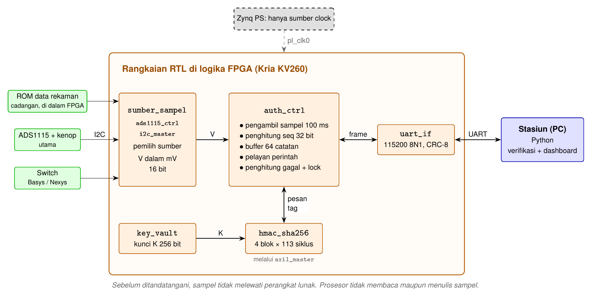

# Spesifikasi SeBatt (Flow B)

Kontrak teknis antara RTL (Muqtada), program stasiun (Budi), dan perangkat keras (Guntur) untuk demo di Kria KV260. Dokumen ini memuat keputusan protokol riwayat. Peta lengkap kode dan cara menjalankannya ada di [context.md](../../context.md), prosedur board di [cara-jalan-board.md](cara-jalan-board.md) dan [RUNBOOK Cmod S7](../../fpga/cmod_s7/RUNBOOK.md). Apabila ada perbedaan soal protokol, dokumen ini yang dipakai.

Penanda status (keadaan repo per commit 200c754, 20 Oktober):
- **[Sudah ada]** sudah diimplementasikan dan lolos simulasi. Uji di board disebut terpisah.
- **[Disepakati]** sudah disetujui, belum diimplementasikan.
- **[Usulan]** menunggu persetujuan Muqtada dan Budi.

## 1. Hal yang Harus Terbukti

Riwayat tegangan yang ditandatangani di dalam chip tidak dapat diubah, dihapus, dipotong, atau diputar balik tanpa terdeteksi stasiun. Semua bagian di bawah ini melayani satu klaim tersebut.

**Aturan jalur data [Disepakati].** Sebelum ditandatangani, sampel tidak boleh melewati perangkat lunak apa pun. Sumber sampel berasal dari pin atau rangkaian RTL, bukan dari prosesor (PS/AXI) dan bukan dari UART. Setelah ditandatangani, data boleh melewati perangkat lunak, dan justru di situlah adegan BMS curang terjadi.

## 2. Blok RTL



| Modul | Tugas | Status |
|---|---|---|
| sha256_core, hmac_sha256 | HMAC-SHA-256, pesan maksimal 55 byte, 4 blok × 113 siklus | [Sudah ada], lolos 5/5 dan 4/4 uji cocotb |
| i2c_master, ads1115_ctrl | Membaca ADS1115 (I2C 100 kHz, alamat 0x48), keluaran milivolt | [Sudah ada], lolos 2/2 uji cocotb. Uji board (T9) belum |
| uart_if | UART 115200 8N1 | [Sudah ada] |
| axil_master | Menulis kunci dan pesan ke register hmac_sha256 | [Sudah ada] |
| auth_ctrl | Pembaca frame, CRC-8, AUTH_REQ → ADC → HMAC → AUTH_RESP | [Sudah ada], lolos 4/4 uji cocotb |
| auth_ctrl, tambahan | Pengambil sampel berkala, seq, buffer, READ_HIST, RESULT, LOCK, UNLOCK, STATUS, lock | [Disepakati], belum dikerjakan |
| sumber_sampel | Pemilih sumber: ADS1115, ROM rekaman, atau switch | [Usulan] |
| key_vault | Kunci 256 bit | Ada sebagai modul, belum dipakai di Flow B. Kunci saat ini ditulis auth_ctrl melalui axil_master |
| sebatt_top | Top level: clock, reset, UART, I2C, LED | [Sudah ada] |

Hasil sintesis yang dilaporkan di context.md: Cmod S7 (xc7s25, clock 12 MHz) WNS +52,7 ns, sekitar 4.400 LUT. KV260 (xck26, 100 MHz) WNS +2,7 ns. Bitstream Cmod S7 belum diuji di board.

Di KV260, blok Zynq UltraScale+ MPSoC hanya dipakai sebagai sumber clock PL (pl_clk0). Prosesor tidak membaca maupun menulis sampel.

## 3. Sumber Sampel

Field tegangan (V) berisi **milivolt 16 bit di masukan sumber**. Untuk ADS1115, nilai ini adalah tegangan di pin AIN0, dihitung di RTL sebagai raw >> 3 (1 LSB = 0,125 mV pada rentang ±4,096 V, nilai negatif dijadikan 0) [Sudah ada]. Faktor pembagi tegangan di luar chip diterapkan di stasiun.

| Kode sumber | Sumber | Isi V | Tegangan baterai di stasiun | Status |
|---|---|---|---|---|
| 0 | ADS1115 + kenop (utama) | mV di AIN0 | V × 5,7 dengan pembagi casing 12 V, atau V × 1 apabila kenop langsung ke AIN0 | [Sudah ada] |
| 1 | ROM data rekaman (cadangan) | mV sel baterai dari dataset | V | [Usulan] |
| 2 | Switch | 3000 + sw[7:0] × 5 | V | Hanya Basys 3 dan Nexys A7 |

- **ADS1115** menjadi sumber utama karena RTL-nya sudah jadi dan kenop fisik dapat diputar juri. Rangkaiannya ada di [rangkaian-adc.md](rangkaian-adc.md).
- **ROM** diisi dari dataset pengosongan baterai (bagian Budi) dan diputar ulang oleh RTL. Sumber ini menjadi cadangan apabila ADS1115 bermasalah di KV260. Input ini sah menurut aturan panitia, asalkan disebutkan di README dan saat pitch.
- Sumber dipilih dengan parameter sintesis atau satu pin Pmod.

## 4. Pengambilan Sampel dan Buffer [Disepakati]

| Parameter | Nilai |
|---|---|
| Periode sampel | 100 ms (parameter SAMPLE_PERIOD dalam siklus clock, karena Cmod S7 12 MHz dan KV260 100 MHz) |
| Arti satu sampel di cerita demo | 3 jam pemakaian |
| Nomor urut (seq) | 32 bit, mulai 0 saat reset, bertambah satu per sampel |
| Buffer | 64 catatan × (seq 4 byte + V 2 byte) = 384 byte, berbentuk ring |
| Saat buffer penuh | Catatan tertua ditimpa, seq tetap bertambah |

Saat ini ads1115_ctrl dipicu satu kali setiap AUTH_REQ. Pada Flow B lengkap, pemicunya adalah pewaktu di auth_ctrl setiap 100 ms. Satu pembacaan single-shot memerlukan sekitar 10 ms ditambah transaksi I2C, sehingga masih muat dalam periode tersebut.

Buffer hanya menyimpan seq dan V. Tanda tangan dihitung saat riwayat diminta, karena isi buffer berada di dalam IP dan tidak dapat diubah dari luar.

## 5. Kunci dan Identitas

| Item | Nilai PoC | Status |
|---|---|---|
| ID baterai | 4 byte, 42 41 54 01 ("BAT\x01") | [Sudah ada] |
| Kunci K | 32 byte, 00 01 02 … 1F, sama untuk semua chip | [Sudah ada] |
| key_vault | Kunci hanya mengalir ke hmac_sha256, tanpa port baca, sekali tulis | [Usulan] |

Pada produk, setiap chip memiliki kunci unik (diisi saat produksi atau diturunkan dari PUF).

## 6. Pesan yang Ditandatangani [Usulan]

Byte pertama membedakan jenis pesan, sehingga tanda tangan untuk satu keperluan tidak dapat dipakai untuk keperluan lain. Semua pesan muat dalam batas 55 byte hmac_sha256.

| Jenis | Isi pesan HMAC | Panjang |
|---|---|---|
| Catatan | 0x53 ‖ ID(4) ‖ seq(4) ‖ V(2) | 11 byte |
| Ringkasan riwayat | 0x48 ‖ nonce(32) ‖ ID(4) ‖ seq_tertua(4) ‖ seq_terakhir(4) | 45 byte |
| Autentikasi | 0x41 ‖ nonce(32) ‖ ID(4) ‖ V(2) | 39 byte |

Semua bilangan big-endian. Tanda tangan ringkasan mengikat nonce dengan rentang seq yang benar-benar ada di chip. Tanpa tanda tangan ini, BMS curang dapat membuang catatan terbaru (misalnya mengirim seq 121–149 padahal chip berisi 121–184) dan urutannya tetap terlihat utuh. Rencana riwayat di context.md bagian 3.4 belum memuat tanda tangan ini.

Pesan autentikasi saat ini masih nonce ‖ ID ‖ V tanpa prefiks, di Python, firmware Flow A, dan RTL Flow B. Penambahan prefiks mengubah vektor uji ketiganya, sehingga diubah bersamaan.

## 7. Frame UART [Sudah ada]

```
[CMD:1][LEN:2, big-endian][PAYLOAD:LEN][CRC8:1]
```

CRC-8 dihitung atas CMD, LEN, dan PAYLOAD dengan polinom 0x31, MSB lebih dulu, nilai awal 0x00. Frame dengan CRC salah dibuang.

## 8. Perintah

| Kode | Nama | Arah | Payload | Status |
|---|---|---|---|---|
| 0x01 | AUTH_REQ | Stasiun → chip | nonce(32) | [Sudah ada] di Python, Flow A, dan RTL |
| 0x02 | AUTH_RESP | Chip → stasiun | ID(4) ‖ V(2) ‖ tag(32) | [Sudah ada] di Python, Flow A, dan RTL |
| 0x03 | RESULT | Stasiun → chip | status(1) | [Sudah ada] di Python dan Flow A, belum di RTL |
| 0x04 | LOCK | Stasiun → chip | – | [Sudah ada] di Python dan Flow A, belum di RTL |
| 0x05 | UNLOCK | Stasiun → chip | – | [Sudah ada] di Python dan Flow A, belum di RTL |
| 0x06 | STATUS | Stasiun → chip | – | [Sudah ada] di Python dan Flow A, belum di RTL |
| 0x07 | READ_HIST_REQ | Stasiun → chip | nonce(32) | [Disepakati] |
| 0x08 | READ_HIST_RESP | Chip → stasiun | lihat di bawah | [Usulan] |
| 0x09 | CHIP_LOCKED | Chip → stasiun | ID(4) | [Usulan] |

**Isi READ_HIST_RESP [Usulan]:**

```
N(1) ‖ seq_tertua(4) ‖ seq_terakhir(4) ‖ N × catatan(38) ‖ tag_ringkasan(32)
catatan = seq(4) ‖ V(2) ‖ tag(32)
```

- N = seq_terakhir − seq_tertua + 1, maksimal 64.
- Ukuran maksimal 1 + 4 + 4 + 64 × 38 + 32 = 2.473 byte, sekitar 215 ms pada 115200 baud.
- Chip yang terkunci membalas READ_HIST_REQ dan AUTH_REQ dengan CHIP_LOCKED.

## 9. Kode Status

| Kode | Nama | Arti | Hasil | Status |
|---|---|---|---|---|
| 0x00 | VALID | Semua pemeriksaan lolos | Diterima | [Sudah ada] |
| 0x01 | INVALID_HMAC | Ada tanda tangan yang tidak cocok, berarti data diubah | Ditolak | [Sudah ada] |
| 0x02 | REPLAY_DETECTED | Nonce tidak cocok atau sudah dipakai | Ditolak | [Sudah ada] |
| 0x03 | BATTERY_LOCKED | Chip atau basis data terkunci | Ditolak | [Sudah ada] |
| 0x04 | UNKNOWN_BATTERY | ID tidak terdaftar | Ditolak | [Sudah ada] |
| 0x05 | HISTORY_GAP | seq bolong di tengah, berarti catatan dibuang | Ditolak | [Usulan] |
| 0x06 | HISTORY_ROLLBACK | seq_terakhir lebih kecil dari catatan basis data | Ditolak | [Usulan] |
| 0x07 | HISTORY_TRUNCATED | seq_tertua lebih besar dari jangkar + 1, berarti catatan lama tertimpa karena buffer penuh | Diterima dengan peringatan | [Usulan] |

## 10. Urutan Verifikasi di Stasiun [Usulan]

Basis data menyimpan jangkar per baterai: {kunci, seq_jangkar, terkunci}.

1. Frame dengan CRC salah dibuang.
2. ID tidak terdaftar: UNKNOWN_BATTERY.
3. Baterai terkunci di basis data, atau chip membalas CHIP_LOCKED: BATTERY_LOCKED.
4. Hitung ulang tag ringkasan dengan nonce yang baru dikirim. Tidak cocok: REPLAY_DETECTED.
5. seq_terakhir < seq_jangkar: HISTORY_ROLLBACK.
6. N ≠ seq_terakhir − seq_tertua + 1, atau seq catatan tidak berurutan dari seq_tertua sampai seq_terakhir: HISTORY_GAP.
7. Hitung ulang tag setiap catatan. Ada yang tidak cocok: INVALID_HMAC.
8. seq_tertua > seq_jangkar + 1: HISTORY_TRUNCATED, catatan di antara keduanya tidak tersedia.
9. Lolos semua: VALID. Simpan seq_jangkar = seq_terakhir, lalu kirim RESULT ke chip.

Nonce dibuat baru untuk setiap permintaan dan hanya berlaku untuk satu jawaban.

## 11. Penguncian Chip [Usulan]

- Penghitung gagal bertambah setiap chip menerima RESULT selain VALID dan HISTORY_TRUNCATED, lalu kembali ke nol setelah RESULT VALID.
- Chip terkunci setelah tiga kegagalan berturut-turut atau satu perintah LOCK.
- UNLOCK pada PoC belum diautentikasi. Hal ini disebut sebagai batasan.
- Penghitung gagal dan status lock hilang saat daya putus.

## 12. Dashboard Live [Usulan]

Stasiun mengirim READ_HIST_REQ setiap 0,5 detik dan menampilkan 64 catatan terakhir. Setiap titik grafik sudah terverifikasi. Perintah tambahan untuk meminta sebagian riwayat tidak dibuat. Tampilan web ada di folder [web](../../web/).

## 13. Pin

**Cmod S7 [Sudah ada]** (dari [cmod_s7.xdc](../../fpga/cmod_s7/cmod_s7.xdc)):

| Sinyal | Pin |
|---|---|
| Clock 12 MHz | M9 |
| Reset (BTN0) | D2 |
| UART TX / RX | L12 / K15, melalui USB-UART bawaan |
| ADS1115 SCL / SDA | JA1 (J2) / JA2 (H2) |
| LED | E2, K1, J1, E1 |

**Pmod KV260 [Usulan].** Nama pin paket diambil dari master XDC KV260.

| Pin Pmod | Sinyal |
|---|---|
| 1 | I2C SCL ke ADS1115 |
| 2 | I2C SDA ke ADS1115 |
| 3 | Tombol pemicu atau pemilih sumber |
| 4 | Bebas |
| 7 | UART TX ke adaptor CP2102 |
| 8 | UART RX dari adaptor CP2102 |
| 9, 10 | LED hijau, merah |
| 5, 11 / 6, 12 | GND / 3,3 V |

Urutan SCL di pin 1 dan SDA di pin 2 sama dengan Cmod S7, sehingga kabel tidak perlu dipindah.

## 14. Vektor Uji

Model Python ([model/protocol.py](../../model/protocol.py)) menjadi referensi. Setelah spesifikasi disetujui, vektor uji berikut dibuat ulang:

- tag catatan dan tag ringkasan dengan prefiks,
- satu dump READ_HIST_RESP lengkap,
- skenario normal, catatan dihapus di tengah, ekor dipotong, kepala dibuang, angka diubah, nonce lama, penghitung diputar balik, dan buffer penuh.

RTL diuji dengan cocotb terhadap vektor yang sama, seperti test_auth_ctrl.py saat ini.

## 15. Batasan PoC

- ADC berupa modul ADS1115 di luar chip, sehingga tegangan dapat dipalsukan sebelum masuk. Pada produk, ADC berada di die yang sama.
- seq, buffer, dan lock bersifat volatil, sehingga produk membutuhkan memori permanen.
- Kunci simetris juga tersimpan di basis data, dan stasiun harus terhubung ke server.
- Kunci uji sama untuk semua chip.
- Apabila sumber ROM dipakai, input berupa data rekaman, bukan sensor live.

## 16. Keputusan yang Perlu Disetujui

| No | Keputusan | Dampak | Disetujui oleh |
|---|---|---|---|
| 1 | Tanda tangan ringkasan di READ_HIST_RESP (bagian 6, 8) | Menutup celah ekor dipotong dan kepala dibuang. context.md bagian 3.4 dan 4.5 disesuaikan | Muqtada, Budi |
| 2 | Prefiks jenis pesan 0x53, 0x48, 0x41 (bagian 6) | Vektor uji Python, Flow A, dan RTL ikut berubah | Muqtada, Budi |
| 3 | V dalam milivolt di masukan sumber, faktor pembagi di stasiun (bagian 3) | Sesuai ads1115_ctrl yang sudah ada | Muqtada, Budi |
| 4 | ADS1115 sebagai sumber utama, ROM rekaman sebagai cadangan (bagian 3) | Demo tetap jalan apabila ADS1115 bermasalah di KV260 | Semua |
| 5 | Status baru 0x05–0x07 dan perintah CHIP_LOCKED (bagian 8, 9) | Python dan RTL bertambah | Muqtada, Budi |
| 6 | Penguncian setelah tiga RESULT gagal (bagian 11) | auth_ctrl bertambah satu penghitung | Muqtada |
| 7 | Dashboard meminta dump penuh setiap 0,5 detik (bagian 12) | Tanpa perintah tambahan | Budi |
| 8 | key_vault tanpa port baca dan sekali tulis, dipakai di Flow B (bagian 5) | auth_ctrl tidak lagi menulis kunci | Muqtada |
| 9 | Pin Pmod KV260 dengan SCL dan SDA di pin 1–2 (bagian 13) | Kabel sama dengan Cmod S7 | Muqtada, Guntur |
